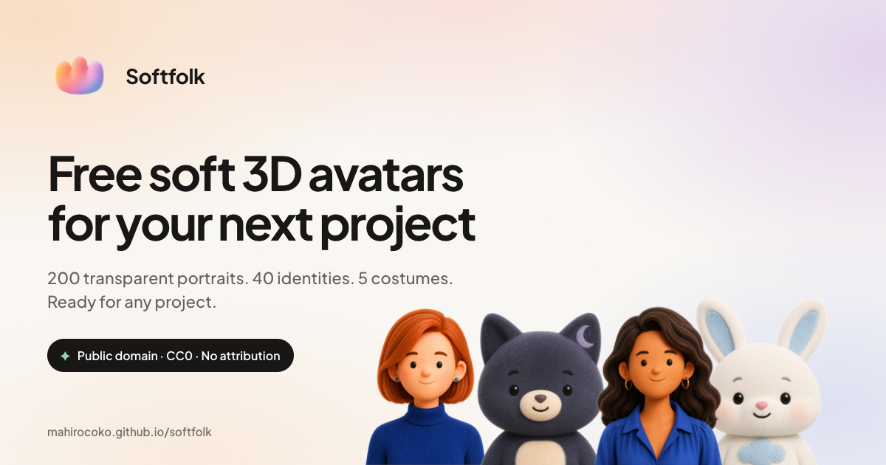

# Softfolk

[](https://mahirocoko.github.io/softfolk/)

Softfolk is a single growing collection of original soft 3D characters (current baseline: 40 identities). Each character comes in five costumes—signature, everyday, work, formal, and yukata—for a total of 200 losslessly optimized transparent 256×256 PNG portraits. New identities append to the collection rather than replacing existing characters.

Use them in profiles, prototypes, mockups, or interfaces. **[Browse the collection →](https://mahirocoko.github.io/softfolk/)**

## Collection

| Identity | Signature | Everyday | Work | Formal | Yukata |
| --- | --- | --- | --- | --- | --- |
| Aster | [`signature`](assets/aster/signature.png) | [`everyday`](assets/aster/everyday.png) | [`work`](assets/aster/work.png) | [`formal`](assets/aster/formal.png) | [`yukata`](assets/aster/yukata.png) |
| Juno | [`signature`](assets/juno/signature.png) | [`everyday`](assets/juno/everyday.png) | [`work`](assets/juno/work.png) | [`formal`](assets/juno/formal.png) | [`yukata`](assets/juno/yukata.png) |
| Kai | [`signature`](assets/kai/signature.png) | [`everyday`](assets/kai/everyday.png) | [`work`](assets/kai/work.png) | [`formal`](assets/kai/formal.png) | [`yukata`](assets/kai/yukata.png) |
| Mira | [`signature`](assets/mira/signature.png) | [`everyday`](assets/mira/everyday.png) | [`work`](assets/mira/work.png) | [`formal`](assets/mira/formal.png) | [`yukata`](assets/mira/yukata.png) |
| Rowan | [`signature`](assets/rowan/signature.png) | [`everyday`](assets/rowan/everyday.png) | [`work`](assets/rowan/work.png) | [`formal`](assets/rowan/formal.png) | [`yukata`](assets/rowan/yukata.png) |
| Noa | [`signature`](assets/noa/signature.png) | [`everyday`](assets/noa/everyday.png) | [`work`](assets/noa/work.png) | [`formal`](assets/noa/formal.png) | [`yukata`](assets/noa/yukata.png) |
| Zuri | [`signature`](assets/zuri/signature.png) | [`everyday`](assets/zuri/everyday.png) | [`work`](assets/zuri/work.png) | [`formal`](assets/zuri/formal.png) | [`yukata`](assets/zuri/yukata.png) |
| Theo | [`signature`](assets/theo/signature.png) | [`everyday`](assets/theo/everyday.png) | [`work`](assets/theo/work.png) | [`formal`](assets/theo/formal.png) | [`yukata`](assets/theo/yukata.png) |
| Ines | [`signature`](assets/ines/signature.png) | [`everyday`](assets/ines/everyday.png) | [`work`](assets/ines/work.png) | [`formal`](assets/ines/formal.png) | [`yukata`](assets/ines/yukata.png) |
| Omar | [`signature`](assets/omar/signature.png) | [`everyday`](assets/omar/everyday.png) | [`work`](assets/omar/work.png) | [`formal`](assets/omar/formal.png) | [`yukata`](assets/omar/yukata.png) |
| Sora | [`signature`](assets/sora/signature.png) | [`everyday`](assets/sora/everyday.png) | [`work`](assets/sora/work.png) | [`formal`](assets/sora/formal.png) | [`yukata`](assets/sora/yukata.png) |
| Eden | [`signature`](assets/eden/signature.png) | [`everyday`](assets/eden/everyday.png) | [`work`](assets/eden/work.png) | [`formal`](assets/eden/formal.png) | [`yukata`](assets/eden/yukata.png) |
| Lumi | [`signature`](assets/lumi/signature.png) | [`everyday`](assets/lumi/everyday.png) | [`work`](assets/lumi/work.png) | [`formal`](assets/lumi/formal.png) | [`yukata`](assets/lumi/yukata.png) |
| Pax | [`signature`](assets/pax/signature.png) | [`everyday`](assets/pax/everyday.png) | [`work`](assets/pax/work.png) | [`formal`](assets/pax/formal.png) | [`yukata`](assets/pax/yukata.png) |
| Marlo | [`signature`](assets/marlo/signature.png) | [`everyday`](assets/marlo/everyday.png) | [`work`](assets/marlo/work.png) | [`formal`](assets/marlo/formal.png) | [`yukata`](assets/marlo/yukata.png) |
| Roux | [`signature`](assets/roux/signature.png) | [`everyday`](assets/roux/everyday.png) | [`work`](assets/roux/work.png) | [`formal`](assets/roux/formal.png) | [`yukata`](assets/roux/yukata.png) |
| Aoi | [`signature`](assets/aoi/signature.png) | [`everyday`](assets/aoi/everyday.png) | [`work`](assets/aoi/work.png) | [`formal`](assets/aoi/formal.png) | [`yukata`](assets/aoi/yukata.png) |
| Mio | [`signature`](assets/mio/signature.png) | [`everyday`](assets/mio/everyday.png) | [`work`](assets/mio/work.png) | [`formal`](assets/mio/formal.png) | [`yukata`](assets/mio/yukata.png) |
| Ren | [`signature`](assets/ren/signature.png) | [`everyday`](assets/ren/everyday.png) | [`work`](assets/ren/work.png) | [`formal`](assets/ren/formal.png) | [`yukata`](assets/ren/yukata.png) |
| Sota | [`signature`](assets/sota/signature.png) | [`everyday`](assets/sota/everyday.png) | [`work`](assets/sota/work.png) | [`formal`](assets/sota/formal.png) | [`yukata`](assets/sota/yukata.png) |
| Moon Cat | [`signature`](assets/moon-cat/signature.png) | [`everyday`](assets/moon-cat/everyday.png) | [`work`](assets/moon-cat/work.png) | [`formal`](assets/moon-cat/formal.png) | [`yukata`](assets/moon-cat/yukata.png) |
| Cloud Bunny | [`signature`](assets/cloud-bunny/signature.png) | [`everyday`](assets/cloud-bunny/everyday.png) | [`work`](assets/cloud-bunny/work.png) | [`formal`](assets/cloud-bunny/formal.png) | [`yukata`](assets/cloud-bunny/yukata.png) |
| Moss Capybara | [`signature`](assets/moss-capybara/signature.png) | [`everyday`](assets/moss-capybara/everyday.png) | [`work`](assets/moss-capybara/work.png) | [`formal`](assets/moss-capybara/formal.png) | [`yukata`](assets/moss-capybara/yukata.png) |
| Star Duck | [`signature`](assets/star-duck/signature.png) | [`everyday`](assets/star-duck/everyday.png) | [`work`](assets/star-duck/work.png) | [`formal`](assets/star-duck/formal.png) | [`yukata`](assets/star-duck/yukata.png) |
| Rain Frog | [`signature`](assets/rain-frog/signature.png) | [`everyday`](assets/rain-frog/everyday.png) | [`work`](assets/rain-frog/work.png) | [`formal`](assets/rain-frog/formal.png) | [`yukata`](assets/rain-frog/yukata.png) |
| Shell Otter | [`signature`](assets/shell-otter/signature.png) | [`everyday`](assets/shell-otter/everyday.png) | [`work`](assets/shell-otter/work.png) | [`formal`](assets/shell-otter/formal.png) | [`yukata`](assets/shell-otter/yukata.png) |
| Ember Fox | [`signature`](assets/ember-fox/signature.png) | [`everyday`](assets/ember-fox/everyday.png) | [`work`](assets/ember-fox/work.png) | [`formal`](assets/ember-fox/formal.png) | [`yukata`](assets/ember-fox/yukata.png) |
| Dusk Bat | [`signature`](assets/dusk-bat/signature.png) | [`everyday`](assets/dusk-bat/everyday.png) | [`work`](assets/dusk-bat/work.png) | [`formal`](assets/dusk-bat/formal.png) | [`yukata`](assets/dusk-bat/yukata.png) |
| Honey Bear | [`signature`](assets/honey-bear/signature.png) | [`everyday`](assets/honey-bear/everyday.png) | [`work`](assets/honey-bear/work.png) | [`formal`](assets/honey-bear/formal.png) | [`yukata`](assets/honey-bear/yukata.png) |
| Peach Hamster | [`signature`](assets/peach-hamster/signature.png) | [`everyday`](assets/peach-hamster/everyday.png) | [`work`](assets/peach-hamster/work.png) | [`formal`](assets/peach-hamster/formal.png) | [`yukata`](assets/peach-hamster/yukata.png) |
| Snow Ferret | [`signature`](assets/snow-ferret/signature.png) | [`everyday`](assets/snow-ferret/everyday.png) | [`work`](assets/snow-ferret/work.png) | [`formal`](assets/snow-ferret/formal.png) | [`yukata`](assets/snow-ferret/yukata.png) |
| Acorn Squirrel | [`signature`](assets/acorn-squirrel/signature.png) | [`everyday`](assets/acorn-squirrel/everyday.png) | [`work`](assets/acorn-squirrel/work.png) | [`formal`](assets/acorn-squirrel/formal.png) | [`yukata`](assets/acorn-squirrel/yukata.png) |
| Puddle Penguin | [`signature`](assets/puddle-penguin/signature.png) | [`everyday`](assets/puddle-penguin/everyday.png) | [`work`](assets/puddle-penguin/work.png) | [`formal`](assets/puddle-penguin/formal.png) | [`yukata`](assets/puddle-penguin/yukata.png) |
| Bloom Deer | [`signature`](assets/bloom-deer/signature.png) | [`everyday`](assets/bloom-deer/everyday.png) | [`work`](assets/bloom-deer/work.png) | [`formal`](assets/bloom-deer/formal.png) | [`yukata`](assets/bloom-deer/yukata.png) |
| Cocoa Raccoon | [`signature`](assets/cocoa-raccoon/signature.png) | [`everyday`](assets/cocoa-raccoon/everyday.png) | [`work`](assets/cocoa-raccoon/work.png) | [`formal`](assets/cocoa-raccoon/formal.png) | [`yukata`](assets/cocoa-raccoon/yukata.png) |
| Lantern Moth | [`signature`](assets/lantern-moth/signature.png) | [`everyday`](assets/lantern-moth/everyday.png) | [`work`](assets/lantern-moth/work.png) | [`formal`](assets/lantern-moth/formal.png) | [`yukata`](assets/lantern-moth/yukata.png) |
| Pebble Seal | [`signature`](assets/pebble-seal/signature.png) | [`everyday`](assets/pebble-seal/everyday.png) | [`work`](assets/pebble-seal/work.png) | [`formal`](assets/pebble-seal/formal.png) | [`yukata`](assets/pebble-seal/yukata.png) |
| Sprout Hedgehog | [`signature`](assets/sprout-hedgehog/signature.png) | [`everyday`](assets/sprout-hedgehog/everyday.png) | [`work`](assets/sprout-hedgehog/work.png) | [`formal`](assets/sprout-hedgehog/formal.png) | [`yukata`](assets/sprout-hedgehog/yukata.png) |
| Comet Shiba | [`signature`](assets/comet-shiba/signature.png) | [`everyday`](assets/comet-shiba/everyday.png) | [`work`](assets/comet-shiba/work.png) | [`formal`](assets/comet-shiba/formal.png) | [`yukata`](assets/comet-shiba/yukata.png) |
| Dream Alpaca | [`signature`](assets/dream-alpaca/signature.png) | [`everyday`](assets/dream-alpaca/everyday.png) | [`work`](assets/dream-alpaca/work.png) | [`formal`](assets/dream-alpaca/formal.png) | [`yukata`](assets/dream-alpaca/yukata.png) |

## Use an avatar

Portraits follow one path pattern:

```text
assets/<identity>/<costume>.png
```

For example:

```html

```

[`data/avatars.json`](data/avatars.json) lists every identity with its kind (`person` or `pal`), costume paths, and discovery tags if you want to build a picker or search the collection.

## Run the website locally

```text
pnpm install
pnpm dev
pnpm verify
```

`pnpm verify` runs the typecheck, tests, production build, and output checks.

## License

Softfolk is released under [CC0 1.0 Universal](LICENSE). You can use, modify, and share the avatars without asking permission or giving credit.
